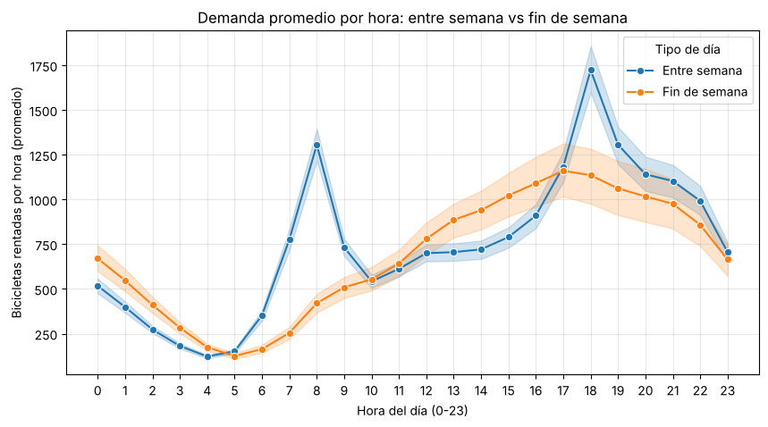
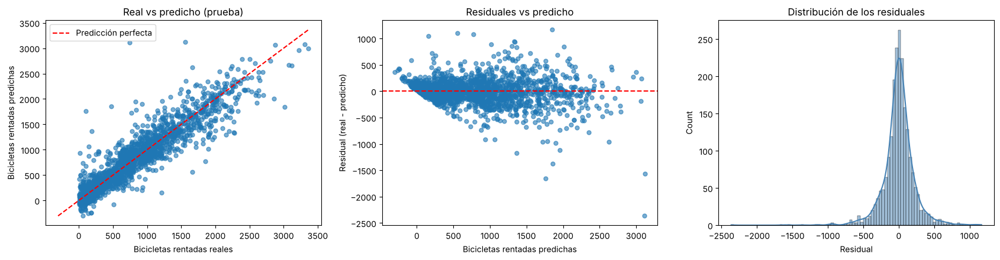

# Predicción de la demanda de bicicletas compartidas en Seúl

Proyecto del curso de Machine Learning. Trabajamos con los registros por hora del sistema público de bicicletas de Seúl (Ttareungyi) para entender de qué depende la demanda y construir un modelo que prediga cuántas bicicletas se van a rentar en cada hora.

**Integrantes:** Juan Esteban Giraldo Giraldo y Federico Avalos Zuleta

## El problema

Seúl tiene un sistema de bicicletas compartidas operado por el gobierno local, con estaciones repartidas por toda la ciudad donde la gente renta y devuelve bicicletas por hora. La demanda cambia muchísimo según la hora, el día de la semana, el clima y la estación del año: en verano, en las horas pico, faltan bicicletas, y en invierno sobran. Si podemos anticipar la demanda, podemos saber cuántas bicicletas tener disponibles sin tener que andar redistribuyendo durante el día (lo cual cuesta camiones, personal y tiene capacidad limitada por turno).

La pregunta que guió el proyecto fue:

> ¿Cómo podemos predecir la demanda de bicicletas por hora, con una proyección a 24 horas, considerando el clima, si es festivo, el día de la semana y las horas pico, para reducir la escasez y la oferta desmedida en el sistema?

Como criterio de negocio nos pusimos una meta concreta: que el total de bicicletas **faltantes + sobrantes** se reduzca en más de un 20 % frente a lo que se haría hoy sin modelo, que es planificar con el promedio histórico de cada hora.

## Datos

El dataset tiene un registro por hora desde diciembre de 2017 hasta noviembre de 2018: 8.760 filas y 14 columnas (fecha, hora, bicicletas rentadas, temperatura, humedad, viento, visibilidad, punto de rocío, radiación solar, lluvia, nieve, estación, festivo y si el sistema estaba funcionando).

**De dónde descargarlo:**

- Fuente original (UCI Machine Learning Repository): https://archive.ics.uci.edu/dataset/560/seoul+bike+sharing+demand
- Copia en Kaggle (re-subida por un tercero, es el mismo archivo): https://www.kaggle.com/datasets/joebeachcapital/seoul-bike-sharing

El archivo que se necesita es `SeoulBikeData.csv`. Hay que ponerlo dentro de la carpeta `data/` del repositorio (no se sube al repo). El CSV viene en codificación latin-1 por el símbolo de grados de la temperatura, por eso en el notebook se lee con `encoding='latin-1'`.

Los datos son reales y se han usado en estudios revisados por pares:

- Sathishkumar V E, Jangwoo Park y Yongyun Cho, *"Using data mining techniques for bike sharing demand prediction in metropolitan city"*, Computer Communications, Vol. 153, pp. 353-366, marzo 2020.
- Sathishkumar V E y Yongyun Cho, *"A rule-based model for Seoul Bike sharing demand prediction using weather data"*, European Journal of Remote Sensing, pp. 1-18, febrero 2020.

## Estructura del repositorio

```
seoul-bike-demand-ml/
├── data/                         # aquí va SeoulBikeData.csv (descargar aparte)
├── images/                       # figuras usadas en este README
├── notebooks/
│   └── seoul_bike_demand.ipynb   # notebook completo: limpieza, EDA, clustering y modelo
├── reports/
│   └── seoul_bike_demand.html    # el mismo notebook exportado, con todas las gráficas
├── requirements.txt
└── README.md
```

Si solo se quiere ver el análisis sin correr nada, el HTML de `reports/` tiene todo el notebook ya ejecutado.

## Cómo correrlo

```bash
git clone https://github.com/juanes4/seoul-bike-demand-ml.git
cd seoul-bike-demand-ml
pip install -r requirements.txt
```

Después de descargar `SeoulBikeData.csv` y dejarlo en `data/`, se abre el notebook desde la carpeta `notebooks/` (la ruta al CSV es relativa: `../data/SeoulBikeData.csv`) y se ejecuta de principio a fin. La búsqueda en rejilla de la red neuronal es la parte que más se demora.

## Preparación de los datos

- Se quitaron las 295 horas en las que el sistema no estaba funcionando (`Functioning Day = No`), porque ahí las rentas son 0 siempre y no tiene sentido predecirlas. Quedan 8.465 filas.
- La fecha se pasó a `datetime` y de ahí se sacaron el día de la semana, el mes y el año.
- No hay valores nulos ni duplicados, pero sí había 17 registros con humedad en 0 %, que es imposible. En vez de borrarlos los interpolamos: como la humedad sigue un ciclo de 24 horas, la interpolación se hace agrupando por hora, o sea, se toma la misma hora del día anterior y del siguiente que sí tengan un dato válido.
- Los outliers (por IQR) que aparecen en rentas, viento, lluvia, nieve y radiación solar no se eliminaron. No son errores de captura sino eventos reales: horas pico, tormentas, nevadas o ráfagas de viento. Quitarlos sería botar información que justamente le sirve al modelo.

## Lo que encontramos en el EDA

La variable objetivo, `Rented Bike Count`, va de 2 a 3.556 bicicletas por hora, con media de 729 y mediana de 542. Está bastante sesgada a la derecha: la mayoría de las horas tiene menos de 500 rentas y muy pocas pasan de 2.500, así que hay pocos ejemplos de picos altos para que el modelo aprenda.

Algunas cosas que salieron del análisis:

- **Temperatura** es la variable con mayor correlación con la demanda (r = 0,56). Las rentas más altas están entre 20 °C y 30 °C, y bajo cero la demanda casi desaparece. Aun así, una regresión lineal solo con temperatura (tomando domingos a las 12:00 para aislar el efecto de la hora) apenas explica el 36 % de la variación.
- **Lluvia y nieve** son eventos raros (llueve en el 6,1 % de las horas y nieva en el 5,2 %), pero cuando pasan tumban la demanda: con lluvia la mediana de rentas pasa de cerca de 600 a menos de 100.
- **Humedad** tiene un rango ideal entre 30 % y 65 %. Por encima de 70-80 % la demanda cae fuerte.
- **Estación:** en verano el promedio pasa de 1.000 bicicletas por hora; en invierno baja a un poco más de 200.
- **Festivos:** reducen el promedio de 739 a 529 rentas por hora.
- **Punto de rocío** está casi perfectamente correlacionado con la temperatura (r = 0,91), así que lo dejamos por fuera para no meter información repetida.

El hallazgo que más nos sirvió fue el del día de la semana. En la matriz de correlación parecía no importar, porque el promedio diario casi no cambia (748 entre semana vs. 682 el fin de semana). Pero cuando se mira hora por hora, la forma de la demanda es completamente distinta:



Entre semana aparecen los dos picos laborales, a las 8:00 a. m. (cerca de 1.300 bicicletas) y a las 6:00 p. m. (más de 1.700). El fin de semana no hay pico en la mañana: la demanda va subiendo desde las 10:00 a. m. y llega a su máximo entre las 3:00 y las 6:00 p. m. con unas 1.150. Entre semana la bicicleta se usa para ir y volver del trabajo; el fin de semana, para pasear. Por eso decidimos meter el día de la semana en la red neuronal, y efectivamente mejoró el error en cerca de un 8 %.

## Modelos

### Descriptivo: clustering con DBSCAN

Usamos DBSCAN para agrupar las horas y para detectar horas atípicas (ruido). Las entradas fueron hora, humedad, temperatura, lluvia, nieve y las dummies de estación y festivo, todas estandarizadas. El día de la semana lo dejamos por fuera del clustering: al volverlo 7 dummies y escalarlo, dos horas de días distintos quedaban a una distancia de casi 4 aunque tuvieran el mismo clima, y DBSCAN terminaba separando los grupos solo por el día.

Para escoger epsilon hicimos un barrido de 0,5 a 6,3 mirando el coeficiente de silueta y el número de clusters. Con epsilon = 3,2 y `min_samples = 5` salieron 8 clusters y 14 horas de ruido, con una silueta media de 0,476 y prácticamente ningún punto con silueta negativa.

Los 8 clusters resultaron ser las 4 estaciones combinadas con festivo / no festivo:

| Cluster | Estación | Tipo de día | Horas | Temp. media | Rentas promedio por hora |
|---|---|---|---|---|---|
| 0 | Invierno | No festivo | 1.966 | -2,8 °C | 233 |
| 1 | Invierno | Festivo | 191 | -0,2 °C | 157 |
| 2 | Primavera | Festivo | 72 | 13,0 °C | 635 |
| 3 | Primavera | No festivo | 2.085 | 13,0 °C | 751 |
| 4 | Verano | No festivo | 2.159 | 26,6 °C | 1.035 |
| 5 | Verano | Festivo | 48 | 27,3 °C | 1.022 |
| 6 | Otoño | No festivo | 1.834 | 13,6 °C | 926 |
| 7 | Otoño | Festivo | 96 | 18,0 °C | 948 |
| -1 (ruido) | Varias | Mayoría no festivo | 14 | 10,8 °C | 65 |

Algo interesante: en invierno y primavera los festivos tienen menos demanda que los días normales, pero en verano y otoño es casi igual, porque con buen clima la gente sale a pasear aunque no trabaje. El ruido son 14 horas de clima extremo (humedad entre 84 % y 98 %, lluvias de hasta 35 mm o nieve de hasta 8,8 cm) en las que casi nadie rentó.

### Predictivo: red neuronal (MLP)

Como en el EDA vimos que las relaciones no son lineales (la humedad tiene un rango ideal, la hora tiene dos picos y la forma del día cambia entre semana y fin de semana), usamos un `MLPRegressor` de scikit-learn. Va dentro de un `Pipeline` con `StandardScaler` para las entradas, y la salida también se estandariza con `TransformedTargetRegressor`. El escalado se ajusta solo con los datos de entrenamiento.

- **Entradas (18 variables):** hora, humedad, temperatura, lluvia, nieve y las dummies de estación, festivo y día de la semana.
- **Salida:** bicicletas rentadas en la hora.
- **Partición:** 75 % entrenamiento / 25 % prueba.
- **Hiperparámetros:** búsqueda en rejilla con validación cruzada de 5 particiones sobre la arquitectura (de 1 a 3 capas ocultas), la activación (ReLU vs. identidad) y la regularización `alpha`, escogiendo por RMSE.

La activación lineal se quedó en un RMSE de casi 440 en todas las arquitecturas, porque una red lineal termina siendo una regresión lineal y no capta los picos. Con ReLU el error baja mucho. La mejor configuración fue **2 capas ocultas de 32 y 16 neuronas, ReLU y alpha = 0,01**. Meter una tercera capa no mejoró nada y sí aumentó la variación entre particiones.

## Resultados

En el conjunto de prueba:

| Métrica | Valor |
|---|---|
| RMSE | 227,4 |
| MAE | 147,8 |
| R² | 0,869 |
| RMSE de la línea base (predecir siempre la media) | 628,6 |

El modelo reduce el error en cerca de un 64 % frente a la línea base, y el RMSE de validación cruzada (232,7) es muy parecido al de prueba, así que no hay señales de sobreajuste.



Los puntos siguen bien la diagonal, pero en las horas de más de 2.500 bicicletas quedan por debajo: el modelo se queda corto en los picos más altos. Los residuales están centrados en 0 (no tiende a predecir de más ni de menos), aunque se abren a medida que la predicción crece, o sea que se equivoca más justo en las horas pico, que es donde más importa. También hay algunas horas de muy baja demanda donde predice valores negativos.

**Contra el criterio de negocio:** si se planifica con el promedio histórico de cada hora, en las horas de prueba habrían faltado 426.203 bicicletas y sobrado 450.899 (877.102 en total). Con el modelo el faltante baja a 156.863 y el sobrante a 155.939 (312.802 en total). Es una reducción del **64,3 %**, muy por encima de la meta del 20 %, y además el modelo queda balanceado: falta casi lo mismo que sobra.

## Limitaciones

- La división entre entrenamiento y prueba fue aleatoria por horas, no por fecha, así que no evalúa directamente la proyección a 24 horas que plantea la pregunta.
- El modelo usa el clima real. Para predecir el día siguiente habría que usar el pronóstico, que tiene su propio error.
- Es un solo año de datos.
- Se queda corto en los picos más altos y a veces predice valores negativos en horas de muy poca demanda.
- La línea base (promedio por hora) es sencilla; una que también tuviera en cuenta la estación daría una reducción menor.

## Lo que sigue

Falta implementar el modelo prescriptivo: una regla que, a partir de las predicciones del MLP para las próximas 24 horas, diga cuántas bicicletas tener disponibles cada día. La idea es tomar el pico horario máximo predicho para el día y sumarle un margen de seguridad calculado con los errores del modelo en ese pico, de forma que no haya que reabastecer durante el día.

## Herramientas

Python, pandas, NumPy, Matplotlib, Seaborn y scikit-learn. El notebook se desarrolló originalmente en Google Colab.
